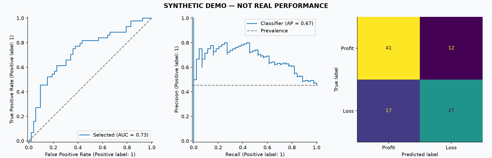

# 기업의 고용과 수익성, 데이터로 다시 검증하기

[](https://github.com/healthy27/data-final/actions/workflows/ci.yml)

**수업용 Colab 분석을 데이터 품질 검사와 연도별 검증을 갖춘 Python 프로젝트로 재구성했습니다.**
재무정보만 사용한 모델과 직원수 정보를 추가한 모델을 비교해, 고용 정보의 추가적인 예측 가치를 검토합니다.

> **현재 공개 결과는 합성 데이터 실행 예제입니다. 실제 기업 분석 성과가 아닙니다.**
> 원래 사용한 엑셀·CSV와 Power Query 변환 내역은 이 저장소에 제공되지 않았습니다.
> 실제 DART 수집 코드는 구현했지만 새 인증키를 사용한 실데이터 실행은 아직 검증하지 않았습니다.
> 원본의 정확도 95.24%를 개선판의 성과로 주장하지 않습니다.



## 어떤 질문에 답하나요?

1. 기업별 직원수 변화율과 규모를 보정한 순이익 변화는 어떤 관련이 있는가?
2. 전년도 재무정보로 다음 해 적자 여부를 구분할 수 있는가?
3. 재무정보에 직원수·직원수 변화율을 추가하면 이전 연도 검증 성능이 개선되는가?

직원수 변화가 수익성을 **유발한다는 인과 추론**은 하지 않습니다. 현재 공시 스냅샷을 쓰므로 과거 시점에 실제 투자할 수 있었다는 **실전 백테스트**도 아닙니다.

## 바로 실행하기 — API 키 불필요

Python 3.12와 [uv](https://docs.astral.sh/uv/getting-started/installation/)가 필요합니다.

```bash
git clone https://github.com/healthy27/data-final.git
cd data-final
uv sync --locked
uv run --locked data-final demo
uv run --locked pytest -q
```

`reports/runs/demo/report.md`를 열면 비교표·ROC/PR 곡선·혼동행렬·변수 중요도·상관분석을 확인할 수 있습니다.
미리 실행한 결과는 [예제 리포트](reports/demo/report.md), 읽기용 설명은 [분석 노트북](notebooks/01_portfolio_walkthrough.ipynb)에 있습니다.

## 기존 분석에서 무엇을 고쳤나요?

| 기존 문제 | 개선 구현 |
| --- | --- |
| 없는 연도를 전년도 값으로 채움 | 연도 대체 금지, 연속 연도만 성장률 계산 |
| 연간·반기, 연결·별도 혼용 가능 | 연간 사업보고서 + OFS 고정, 응답 식별자 검사 |
| 모르는 순이익을 중앙값으로 채워 정답 생성 | 결측·손익 0의 타깃 제외, 제외 정책 명시 |
| 전체 데이터에서 결측 대체 후 분할 | 매 학습 fold 내부 Pipeline에서 대체·스케일링 |
| 같은 해 손익 관련 항목으로 같은 해 흑자 분류 | t년의 제한된 변수로 t+1년 적자 분류 |
| 단일 랜덤 분할의 정확도 중심 | 연도별 검증, AP로 모델 선택, 마지막 연도 평가 |
| 복잡한 모델 하나 | 클래스 사전확률·전년 손익 유지 기준, 로지스틱·트리 부스팅 비교 |
| 변수 중요도만으로 고용의 의미 해석 | 고용 변수 유무 비교, 검증 성능과 해석 한계 기록 |
| 기업명 부분일치·중복 합산 | 종목코드로 고유번호 조회, 모호한 계정은 결측·감사 기록 |
| 수동 엑셀 변환과 노출된 키 | 명시적 데이터 계약, 환경변수, 캐시·해시·테스트·CI |

세부 판단과 남은 한계: [방법론 및 모델 카드](docs/methodology.md), [원본 검토 기록](docs/original_review.md).

## 실제 DART 데이터로 실행

원본 Colab에 노출되었던 키는 재사용하지 말고 새 키를 발급받아 로컬 환경변수로 설정합니다.
키는 커밋하거나 채팅에 붙여넣지 않습니다. `.env.example`은 형식 안내이며 자동으로 로드되지 않습니다.

```bash
# 셸에서 새 키를 설정한 다음 아래 명령을 실행합니다.
# export DART_API_KEY=...  (실제 키를 문서나 저장소에 기록하지 마세요.)
uv run --locked data-final collect \
  --universe configs/universe.example.csv --start-year 2018 --end-year 2024
uv run --locked data-final validate data/processed/panel.csv
uv run --locked data-final analyze data/processed/panel.csv --test-year 2024
```

예시 기업 목록은 **접속 확인용 8개 기업**입니다. 대표 표본이 아니며, 클래스 부족으로 분석이 중단될 수 있습니다.
본 분석 전에는 선정 시점·업종·상장 상태가 문서화된 충분한 기업 표본으로 교체해야 합니다.
현재 기업 목록을 과거에 적용하면 생존편향이 생길 수 있습니다.

수집 후 `panel.audit.json`의 누락·모호한 계정, 직원수 집계, 원문 접수번호를 검토하세요.
직원수와 재무정보의 범위를 맞추기 위해 OFS를 사용하지만, 실제 공시의 직원 포함 범위는 별도 확인이 필요합니다.
응답 원본과 수집 시각은 `data/raw/dart/`에 캐시됩니다. 새 스냅샷은 다른 `--cache` 경로로 수집합니다.
실제 원본·결과는 기본적으로 Git에서 제외합니다.

## 저장소 구조

```text
src/data_final/
  dart.py           # API 수집, 숫자 파싱, 계정 매핑, 감사 기록
  data.py           # 데이터 계약, 시차 변수, 합성 예제
  analysis.py       # 연도별 모델 비교, 평가·차트·리포트
  cli.py            # demo / collect / validate / analyze
tests/              # 연도 혼합, 타깃 결측, 누수, 모호한 집계 회귀 테스트
configs/            # 명시적 기업 표본
notebooks/          # 결과를 설명하는 포트폴리오 노트북
docs/               # 데이터 사전, 설계 근거, 이력서 작성 가이드
reports/demo/       # 합성 데이터 예제 결과
uv.lock             # 의존성 버전 고정
```

## 포트폴리오에서 보여줄 것

“높은 정확도”보다 **문제를 발견하고 검증 설계를 바꾼 과정**을 설명하는 프로젝트입니다.
실데이터 결과를 얻기 전에는 시스템 구현·테스트 경험까지만 성과로 표현하세요.
[발표·이력서 가이드](docs/portfolio.md)에 검증 가능한 표현과 실데이터 완료 기준을 정리했습니다.

## 참고한 공식 자료

- [DART 전체 재무제표](https://opendart.fss.or.kr/guide/detail.do?apiGrpCd=DS003&apiId=2019020): 계정 식별자·기간·보고서 기준을 유지하는 수집 설계.
- [DART 직원 현황](https://opendart.fss.or.kr/guide/detail.do?apiGrpCd=DS002&apiId=2019011): 직원수 집계 원천.
- [scikit-learn 데이터 누수 방지](https://scikit-learn.org/stable/common_pitfalls.html): 학습 데이터 내부 전처리.
- [Permutation importance](https://scikit-learn.org/stable/modules/permutation_importance.html): 모델 해석과 상관된 변수의 한계.
- [uv lockfile](https://docs.astral.sh/uv/concepts/projects/sync/): 환경 재현.

원본 프로젝트: [수업 Colab](https://colab.research.google.com/drive/127xObPPWqpLnHoqjdiXId0Dhkakf9tzL).
원본 노트북은 인증키가 포함되어 있어 그대로 복사하지 않았습니다.
