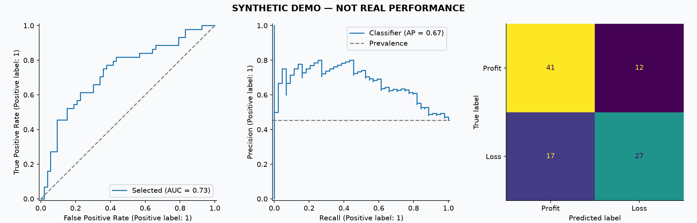
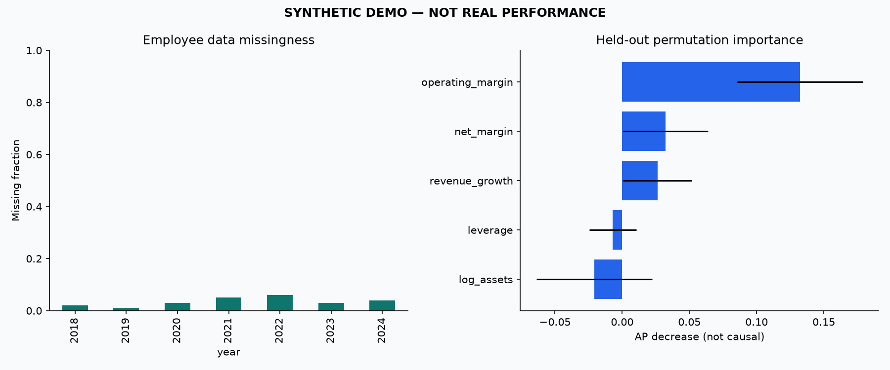

# Financial & employment analysis

> **SYNTHETIC DEMO — NOT REAL PERFORMANCE**

합성 데이터로 실행 경로를 검증한 예제이며 실제 기업에 대한 결론이 아닙니다.

## Research question
전년도 재무·고용 정보가 다음 해 적자 여부를 구분하는 데 도움이 되는가?
직원수 추가 효과는 아래 financial / financial_employment 검증 결과를 비교합니다.

## Selection on earlier years
| model | features | mean_validation_ap | std_validation_ap | mean_validation_auc | folds |
| --- | --- | --- | --- | --- | --- |
| hist_gradient_boosting | financial | 0.6720 | 0.0852 | 0.6813 | 3 |
| logistic | financial | 0.6481 | 0.1179 | 0.6928 | 3 |
| hist_gradient_boosting | financial_employment | 0.6381 | 0.0908 | 0.6640 | 3 |
| logistic | financial_employment | 0.6313 | 0.1367 | 0.6798 | 3 |
| dummy | financial | 0.4449 | 0.0555 | 0.5000 | 3 |

## Held-out year: 2024
선택 모델: **hist_gradient_boosting / financial**. 양성 클래스는 적자, 임계값은 0.5 고정.

| model | n | loss_prevalence | accuracy | balanced_accuracy | loss_precision | loss_recall | loss_f1 | roc_auc | average_precision | brier |
| --- | --- | --- | --- | --- | --- | --- | --- | --- | --- | --- |
| selected | 97 | 0.4536 | 0.7010 | 0.6936 | 0.6923 | 0.6136 | 0.6506 | 0.7316 | 0.6693 | 0.2135 |
| training_class_prior | 97 | 0.4536 | 0.5464 | 0.5000 | 0.0000 | 0.0000 | 0.0000 | 0.5000 | 0.4536 | 0.2504 |
| previous_year_loss | 97 | 0.4536 | 0.6598 | 0.6597 | 0.6170 | 0.6591 | 0.6374 | 0.6533 | 0.5613 | 0.3436 |

## Employment / income change association
직원수 변화율과 전기 자산으로 나눈 순이익 증감의 연도별 상관계수입니다.
완전한 관측 쌍만 사용합니다. 인과관계나 전체 상장사에 대한 대표성을 의미하지 않습니다.

| year | n_complete_pairs | pearson_r | spearman_r |
| --- | --- | --- | --- |
| 2019 | 94 | -0.0042 | 0.0010 |
| 2020 | 92 | 0.0574 | 0.0628 |
| 2021 | 89 | 0.0471 | 0.0024 |
| 2022 | 82 | 0.0509 | 0.0630 |
| 2023 | 84 | -0.1300 | -0.1442 |
| 2024 | 88 | -0.1116 | -0.1254 |

## Reproducibility and limits
- Missing/zero outcomes excluded; feature imputation fitted within each training fold.
- Input hash, source hash, versions, confidence intervals: `metrics.json`.
- The cohort is not necessarily representative; firms repeat across years.
- Annual reports become available after fiscal year-end; current snapshots may be restated.
- Employment scope needs source-document checks even when OFS is used.
- Bootstrap intervals condition on this fitted model and test year's class composition.
- Correlated predictors can share importance. Negative importance is retained.
- Do not tune the model after viewing this held-out result and still call it untouched.
