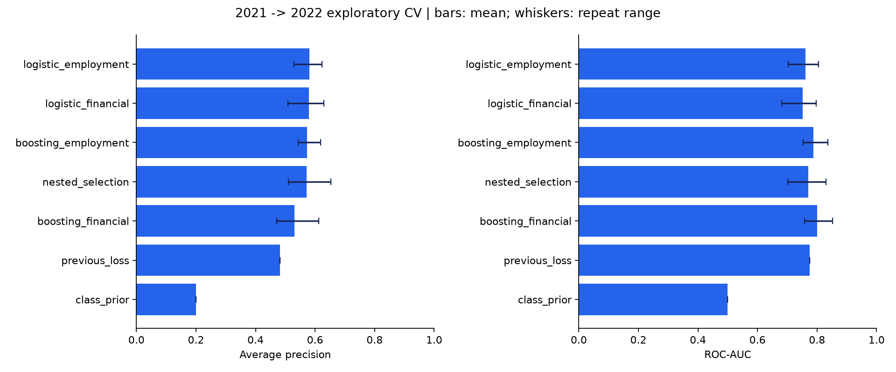
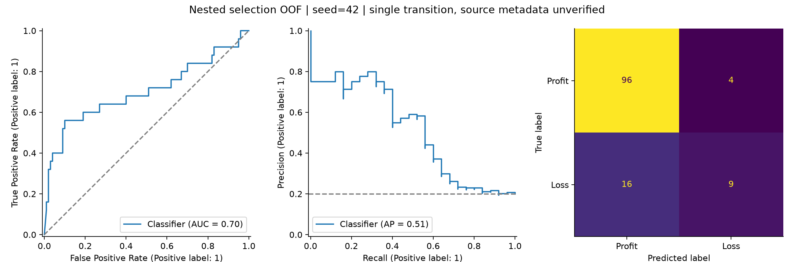
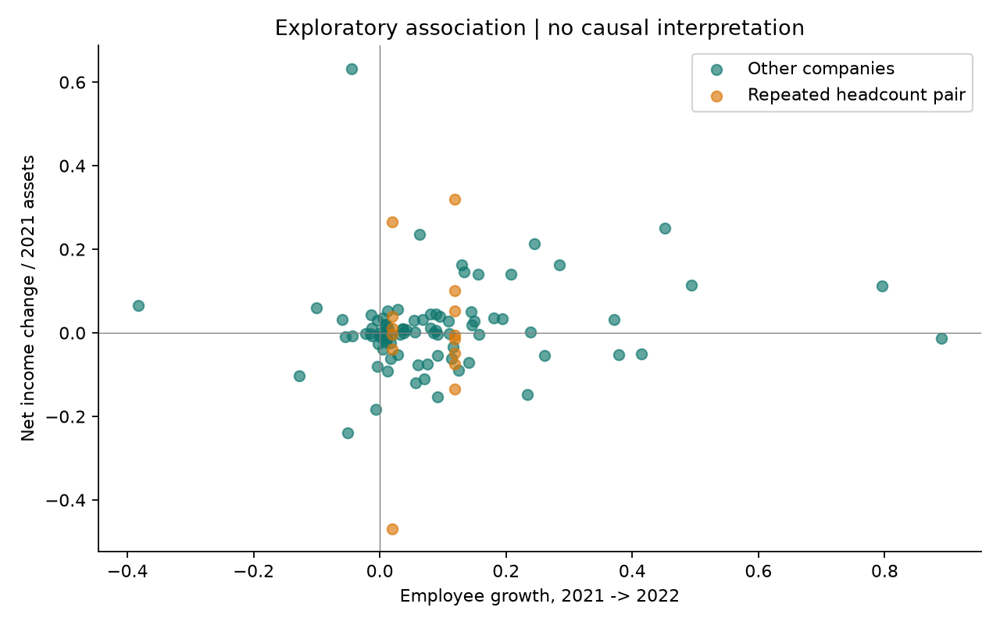

# 제공 자료의 실데이터 재분석

**2021 → 2022년의 단일 전환을 분석한 탐색 결과입니다. 공시 원문 메타데이터는 미검증입니다.**

분석 대상 125개 기업, 2022년 적자 25개.
2021년의 비율형 재무 변수 4개와 직원수 1개만 허용했습니다.
원본 통화를 알 수 없어 기업 간 원시 금액 크기 비교는 제외했습니다.
같은 회사 안의 분자·분모 단위와 연결 범위가 같다는 가정은 남아 있습니다.

## 평가
5-fold 기업 분할을 5개 seed로 반복했습니다.
회사는 한 repeat 안에서 한 번만 외부 평가를 받습니다.
외부 학습 기업 안에서 3-fold AP로 모델·피처 구성을 선택했습니다.
외부 평가 기업에는 선택 결과만 적용했습니다.
`nested_selection`은 이 선택 절차의 평가이며, 다른 행은 사전에 고정한 비교 실험입니다.
표는 repeat별 OOF 전체 점수의 평균입니다. 반복 범위는 신뢰구간이 아닙니다.

| model | n | roc_auc_mean | average_precision_mean | accuracy_mean | loss_recall_mean | loss_f1_mean |
| --- | --- | --- | --- | --- | --- | --- |
| boosting_employment | 125 | 0.7875 | 0.5736 | 0.8496 | 0.4720 | 0.5565 |
| boosting_financial | 125 | 0.8004 | 0.5301 | 0.8544 | 0.5200 | 0.5898 |
| class_prior | 125 | 0.5000 | 0.2000 | 0.8000 | 0.0000 | 0.0000 |
| logistic_employment | 125 | 0.7615 | 0.5807 | 0.8496 | 0.3440 | 0.4772 |
| logistic_financial | 125 | 0.7510 | 0.5796 | 0.8464 | 0.3200 | 0.4541 |
| nested_selection | 125 | 0.7712 | 0.5708 | 0.8352 | 0.3840 | 0.4830 |
| previous_loss | 125 | 0.7750 | 0.4816 | 0.8560 | 0.6400 | 0.6400 |

## 직원수의 추가 가치
동일한 로지스틱 모델과 동일한 분할에서 직원수 추가 전후 AP 차이의 평균은
+0.0011입니다.
다른 모델 간 차이를 직원수의 효과라고 해석하지 않습니다.

| seed | employment_ap_delta | employment_auc_delta |
| --- | --- | --- |
| 42 | 0.0200 | 0.0212 |
| 43 | 0.0106 | 0.0104 |
| 44 | -0.0077 | 0.0136 |
| 45 | -0.0072 | 0.0080 |
| 46 | -0.0104 | -0.0004 |

반복된 직원수 쌍이 있는 기업을 제외한 110개 기업의 민감도 분석:

| model | n | roc_auc_mean | average_precision_mean | accuracy_mean | loss_recall_mean | loss_f1_mean |
| --- | --- | --- | --- | --- | --- | --- |
| class_prior | 110 | 0.4670 | 0.1996 | 0.7909 | 0.0000 | 0.0000 |
| logistic_employment | 110 | 0.7352 | 0.5797 | 0.8455 | 0.3304 | 0.4714 |
| logistic_financial | 110 | 0.7235 | 0.5884 | 0.8364 | 0.2783 | 0.4152 |
| previous_loss | 110 | 0.7641 | 0.4876 | 0.8545 | 0.6087 | 0.6364 |

## 고용 변화와 수익 변화의 관련성
직원수 변화율과 순이익 변화/2021년 자산의 상관계수입니다. p값은 탐색용입니다.

| sample | n | pearson_r | pearson_p_exploratory | spearman_r | spearman_p_exploratory |
| --- | --- | --- | --- | --- | --- |
| all_complete_pairs | 102 | 0.1232 | 0.2175 | 0.1524 | 0.1261 |
| exclude_repeated_employee_pairs | 88 | 0.1355 | 0.2080 | 0.1727 | 0.1076 |

## 해석 범위
한 해의 기업 간 구분 능력을 측정했습니다.
새로운 경기 국면이나 여러 미래 연도의 성능은 확인하지 않았습니다.
반복된 직원수 값은 검토 신호이며 그것만으로 대체값이라고 확정하지 않았습니다.
금액의 통화, 연결/별도, 실제 수집 연도, 공시 시점을 원문에서 검증해야 합니다.
원본 95.24%는 같은 해 380개 항목을 사용한 다른 문제의 결과라서 이 점수와 증감 비교하지 않습니다.
